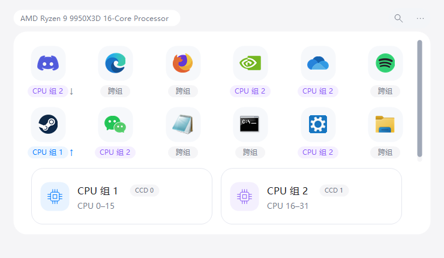

<p align="center"></p>
<h1 align="center">CoreLane</h1>
<p align="center">在 Windows 上，拖动应用图标就能分配 CPU 核心。</p>
<p align="center"><a href="#快速上手">快速上手</a> · <a href="#从源码运行">从源码运行</a> · <a href="#反馈">反馈</a></p>

同时开着游戏、语音和录屏时，如果想让它们使用不同的 CPU 核心，可以在 CoreLane 里直接拖动应用图标。也可以双击图标精确选核、调整进程优先级，或把已经试好的分配保存下来，下次启用方案时自动执行。

<p align="center"></p>
<p align="center"><sub>v0.13.13 的界面，使用示例进程和 CPU 分配。</sub></p>

## 快速上手

1. 打开一个适合测试的应用，例如记事本。鼠标移到放大镜上，输入应用名找到它。悬停在应用图标上可以先看当前分配。
2. 把应用图标拖到下方的 CPU 卡片上。要一起分配多个应用，可以在空白处框选，也可以按住 Ctrl 逐个选中。松手后看图标下方的分配标签，操作结果会显示在窗口底部。
3. 想精确指定某几个逻辑 CPU，双击应用图标，展开「核心分配」，勾选后点击「应用设置」。同一窗口也可以调整进程优先级。
4. 试完后，保持应用选中，打开「⋯ → 恢复原设置 → 恢复已选」，把该应用的调度交还给 Windows。

## 能做什么

| 功能 | 怎么用 |
| --- | --- |
| 查看应用分配 | 图标下显示 CPU 组、跨组或混合分配等状态。悬停可查看具体范围、进程优先级和最近操作。 |
| 按组拖放 | Intel 大小核得到确认时显示 P 核和 E 核。AMD 按 Windows 提供的 L3 共享范围分组，并以 CCD 标签标注显示顺序。 |
| 精确选核 | 在「核心分配」中逐个勾选逻辑 CPU，也可以按住鼠标划选。拖放使用硬亲和性，应用设置还可选择进程默认 CPU 集。 |
| 调整优先级 | 在「进程优先级」中统一设置或逐个调整。托盘中的「方案优先级与后台保护」可以为指定后台应用配置临时降级。 |
| 保存并自动应用 | 在「⋯ → 自动方案 → 保存方案」中保存本次使用期间成功的手动分配。选择并启用对应方案后，工具会处理匹配的应用及随后启动的实例。 |

### 游戏方案

从「⋯ → 自动方案」选择「游戏」并启用。符合条件的未分类应用新启动并打开窗口时，CoreLane 会询问是不是游戏，并记住你的选择。游戏默认使用 P 核或 CPU 组 1，非游戏默认使用 E 核或 CPU 组 2。本机缺少第二组时，非游戏只记录分类。

已有分类可在「管理方案与游戏分类」中调整。已保存的应用专属规则优先于游戏分类。关闭主窗口后，已启用的方案可继续在托盘运行。手动分配会暂停当前方案，也可以右键托盘图标手动暂停。

### 保留和恢复

- **保留并退出**会保存本次成功的手动设置，下次打开 CoreLane 时继续应用。
- **恢复原设置**可选择恢复已选应用或全部有记录的应用。恢复会开放 Windows 提供的全部可用 CPU、清除默认 CPU 集，并将优先级设为正常。
- 方案、保留的分配和恢复记录放在程序旁的 **`data/`** 文件夹。升级或移动程序时，把这个文件夹一起保留。
- 「⋯ → 卸载」提供「保留设置卸载」和「完全卸载」，两种方式都会先恢复有记录的进程调度。

## 从源码运行

**需要 Windows 11 x64 和 .NET Framework 4.8。** 使用 Windows 自带的 C# 编译器。当前版本为 **v0.13.13**。GitHub Releases 上目前可见的是早期预发行版，要体验本页功能请从当前源码构建。

```powershell
git clone https://github.com/AYdiodio/CoreLane.git
cd CoreLane
.\Start.cmd
```

第一次运行时，`Start.cmd` 会编译并打开 `dist\CoreLane.v0.13.13.exe`。需要管理员权限时，先构建一次，再运行 `StartAdmin.cmd`。如需登录 Windows 后自动启动，可从「⋯ → 开机自启动」授权。

## 适用范围

- 支持单个 Windows 处理器组内的分配，最多 64 个逻辑 CPU。多处理器组设备可查看拓扑。实际可选范围以本机检测结果为准。
- 硬亲和性限定进程可使用的 CPU 范围。默认 CPU 集用于未单独指定 CPU 集的线程，也受硬亲和性限制。
- 进程是否允许修改由 Windows 和目标进程的保护策略决定。遇到拒绝访问时，先选中应用，再用「⋯ → 检查所选应用权限」查看具体原因。
- 核心分配适合验证特定场景下的资源安排。帧率和延迟是否改善，需要用同一场景实测。

## 开发与测试

使用 C#、WinForms 和 .NET Framework 4.8。`Build.cmd` 构建，`Test.cmd` 构建并运行回归测试。报告位于 `test-output/self-test.txt`。关于测试覆盖和界面约定，见 [验证记录](VALIDATION.md)及[界面约定](UI_GUIDELINES.md)。

## 反馈

报告问题时，可以附上 Windows 版本、CPU 型号、CoreLane 版本、复现步骤和错误提示。 [提交问题](https://github.com/AYdiodio/CoreLane/issues)
